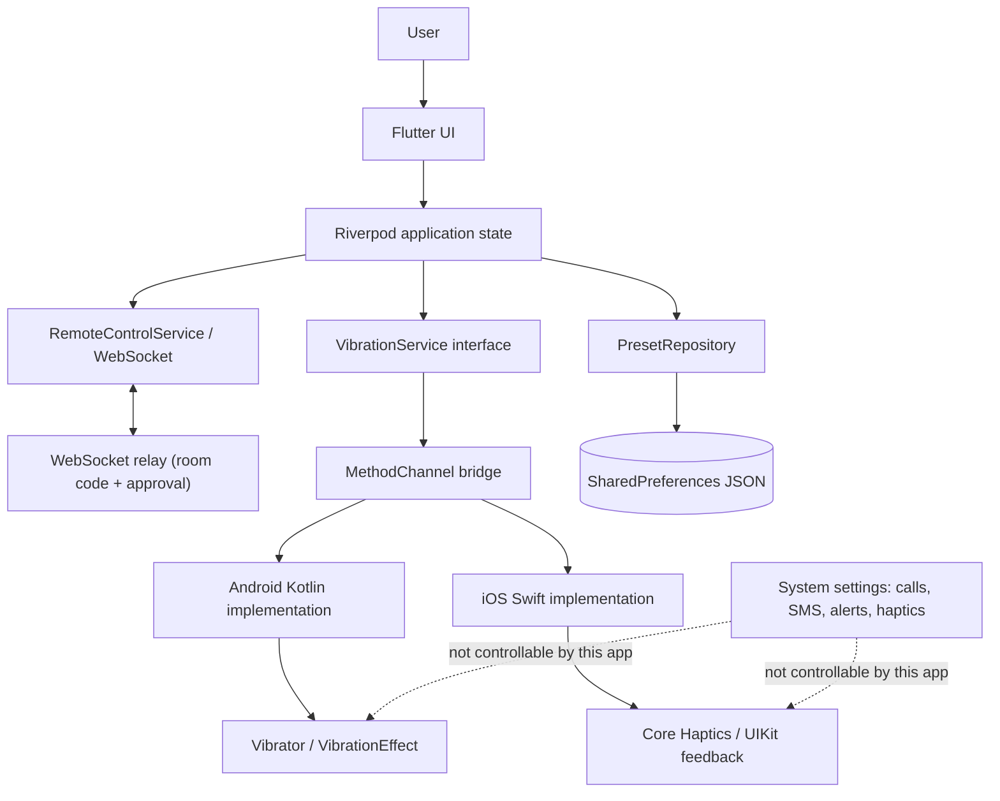

# Technical Architecture

> **Status:** Approved planning baseline, 2026-10-30; remote relay added 2026-11-01.
> **Source:** `VIBRATION_CONTROL_PLAN.md`, Sections 7-10 and 19.
> **Implementation status:** Local MVP and Android playback are implemented. Paired remote haptics are implemented with a Node WebSocket relay. Persistence and iOS remain pending.

## 1. Architecture Goals

- Keep widgets free of native calls.
- Expose one narrow haptics contract.
- Model platform differences instead of hiding them.
- Keep the domain layer small and testable.
- Use local-only persistence with a migration path.
- Make unsupported hardware a first-class UI state.
- Keep remote control behind an explicit, revocable pairing session.
- Avoid dependencies unless recorded in `DECISIONS.md`.

## 2. Technology Stack

| Layer | Choice | Reason |
|---|---|---|
| UI | Flutter stable, Material 3 | Shared UI and fast iteration |
| State | Riverpod 3.4.3 without code generation | Testable injection, async capability loading, no `BuildContext` dependency |
| Persistence | `shared_preferences` 2.5.6 with versioned JSON | Small data volume, no relational queries, simple migration |
| Native bridge | `MethodChannel` | Small contract, explicit errors, easy to validate |
| Android | Kotlin, `VibratorManager` or `Vibrator`, `VibrationEffect` | Official APIs and controlled fallback |
| iOS | Swift, Core Haptics, UIKit feedback generators | Official APIs and engine lifecycle control |
| IDs | `uuid` 4.6.0 | Stable preset identifiers |
| Remote transport | `web_socket_channel` 3.0.3 | Works on Android, web, and desktop; simple relay protocol |
| Remote relay | Node.js 24 + `ws` | Ephemeral room codes, host approval, no persistence |
| Testing | `flutter_test`, `integration_test`, fakes or `mocktail` | Unit, widget, and integration coverage |
| Lint | `flutter_lints` 6.0.0 | Standard Flutter checks |
| Analytics | None | Privacy and scope |

No package may be added before its purpose and alternative are recorded in `docs/DECISIONS.md`.

## 2.1 Current Stage 3-8 Implementation

- `PreviewVibrationService` provides simulated capabilities and playback for Chrome and non-Android hosts.
- `AndroidVibrationService` maps the service contract to `MainActivity.kt` through a MethodChannel.
- `lib/providers/app_state.dart` selects Android native playback on Android and owns navigation, settings, presets, capability loading, and playback state.
- `lib/providers/remote_control_controller.dart` owns remote-session state, approval, strength throttling, and the bridge from relay commands to local playback.
- `WebSocketRemoteControlService` implements the relay protocol on top of `web_socket_channel`; tests replace it through `remoteServiceFactoryProvider`.
- The `relay/` directory contains a small Node.js WebSocket relay with room codes, host approval, role checks, rate limits, and expiry.
- Source and configuration explanation files live under `docs/code/`, mirroring the repository path instead of sitting beside source files.
- Reusable app, capability, and platform text constants live under `lib/constants/`.
- Shared light/dark theme and Manrope typography live in `lib/theme/app_theme.dart`; the font is bundled under `assets/fonts/`.
- Settings and user presets are in memory only; SharedPreferences persistence is deferred to Stage 9.
- The web target exists for UI review and can act as a remote controller; it is still not a haptic delivery target.
- The Android and iOS platform IDs use the placeholder `com.example.vibration_control`.
- Android `minSdk` is 26. The generated iOS deployment target is 15.0 and must be reconciled with the approved iOS 13 minimum before iOS implementation.
- Android native capability reporting, amplitude/on-off playback, stop, and app-background cancellation are implemented.
- Physical Android playback is confirmed; maximum normal touch-channel output remains weak on the test phone.
- All playback uses normal app haptics only. Remote control only changes app-generated haptics on the paired phone.
- Flutter web and Android debug builds succeed.

## 3. Layered Structure

```text
lib/
  main.dart
  app.dart
  constants/
    app_strings.dart
    capability_strings.dart
    platform_strings.dart
  config/
    remote_config.dart
  theme/
    app_theme.dart
  models/
    vibration_models.dart
    remote_models.dart
  providers/
    app_state.dart
    remote_control_controller.dart
  services/
    vibration_service.dart
    android_vibration_service.dart
    preview_vibration_service.dart
    remote_control_service.dart
    websocket_remote_control_service.dart
  utils/
    vibration_validator.dart
    remote_validator.dart
  widgets/
    app_widgets.dart
    preset_tile.dart
    vibration_graph.dart
  pages/
    home_page.dart
    remote_page.dart
    settings_page.dart
relay/
  server.js
  tests/relay.test.js
  Dockerfile
docs/
  code/
    lib/...
    test/...
    relay/...
    android/...
    ios/...
    web/...
```

`lib/pages/pattern_editor_page.dart` is reserved for post-MVP work and must not be implemented in the MVP. Per-file explanations mirror the source path under `docs/code/` rather than sitting beside the code.

## 4. Layer Responsibilities

| Layer | Responsibility | Must not do |
|---|---|---|
| Presentation | Screens, widgets, accessibility, loading/error/empty states | Call native APIs directly |
| Application | Controllers, orchestration, debouncing, lifecycle reactions | Contain platform-specific constants |
| Domain | Immutable models, validation, service interfaces, typed results | Import Flutter widgets or platform channels |
| Data | Settings and preset repositories, JSON mapping, migrations | Decide whether hardware supports haptics |
| Platform | MethodChannel adapter, request/response mapping, native error translation | Contain UI decisions |
| Native | Capability reporting, playback, cancellation, engine lifecycle | Claim success after an unreported fallback |

## 5. State Management

Riverpod is used without code generation.

### Controllers

| Controller | Responsibility |
|---|---|
| `CapabilityController` | Load, cache, and expose the capability report and bridge errors |
| `SettingsController` | Load, update, validate, and save app settings |
| `PresetController` | List, save, rename, delete, and select user presets |
| `PlaybackController` | Validate requests, debounce, play, stop, and track effective mode |
| `RemoteController` | Own relay connection state, host approval, controller commands, debounce, and remote playback bridge |

### State rules

- Capability loading is asynchronous and must not block the first frame.
- One active playback session is allowed.
- A new user-initiated test cancels the previous test.
- Rapid taps are debounced.
- Playback results carry a session token so a stale play result cannot override a newer play or stop.
- Playback state resets when the app enters the background.
- Platform fallback is visible to the user and is never reported as full support.
- Remote sessions require host approval and are foreground-only.
- Remote strength updates are debounced; connect and haptic operations use tokens to ignore stale async results.
- Remote disconnect, session expiry, peer leave, or app backgrounding stops playback and clears the session.

## 6. Domain Models

### VibrationSegment

| Field | Type | Rules |
|---|---|---|
| `vibrationMs` | integer | 20-5000 ms |
| `pauseAfterMs` | integer | 0-5000 ms |
| `strengthPercent` | integer | 1-100 |

### VibrationPreset

| Field | Type | Rules |
|---|---|---|
| `id` | string | UUID |
| `name` | string | 1-40 characters after trim |
| `segments` | list | 1-10 segments |
| `repeatCount` | integer | 1-5 |
| `createdOnPlatform` | enum | Metadata only; never gates compatibility |
| `updatedAt` | ISO-8601 string | Optional |

### AppSettings

| Field | Type | Default |
|---|---|---|
| `defaultDurationMs` | integer | 300 |
| `defaultStrengthPercent` | integer | 50 |
| `selectedPresetId` | string or null | null |
| `appHapticsEnabled` | boolean | true |

### CapabilityReport

| Field | Type | Meaning |
|---|---|---|
| `platform` | Android or iOS | Runtime platform |
| `osVersion` | string | Display and diagnostics |
| `hasActuator` | boolean | `hasVibrator` or `supportsHaptics` |
| `supportsAmplitude` | boolean | Android hardware capability |
| `supportsIntensity` | boolean | iOS Core Haptics intensity |
| `supportsCustomPatterns` | boolean | Derived from runtime capability |
| `supportsStop` | boolean | Advanced player or stop is available |
| `supportsCoreHaptics` | boolean | iOS only |
| `supportsLegacyVibration` | boolean | iOS fallback |
| `warnings` | list of strings | Known limitations |

### PlaybackResult

| Field | Type | Meaning |
|---|---|---|
| `started` | boolean | Playback started |
| `effectiveMode` | enum | `amplitude`, `onOff`, `fixed`, or `unsupported` |
| `warnings` | list of strings | Fallbacks and caveats |
| `errorCode` | enum or null | Structured failure |
| `requestId` | string | Stale-result protection |

### RemoteState and events

- `RemoteState` is immutable UI state for role, phase, room code, peer name, strength, playback status, and user-facing messages.
- `RemoteEvent` is a sealed hierarchy for relay messages: room creation, join request/wait/decline, session start/end, haptic command/status, server error, and disconnect.
- The parser rejects malformed or unknown events. Remote payloads never contain presets, accounts, contact data, or device identifiers.

## 7. Native Bridge Contract

Channel name: `com.example.vibration_control/haptics`

| Operation | Input | Success | Failure |
|---|---|---|---|
| `getCapabilities` | none | Platform, OS, actuator, amplitude/intensity, pattern, stop, Core Haptics, legacy vibration, warnings | Typed bridge error |
| `play` | Request ID, repeat count, and segments | Started, effective mode, warnings | `NO_VIBRATOR`, `UNSUPPORTED`, `INVALID_ARGUMENT`, `BUSY`, `INTERRUPTED`, `PLATFORM_ERROR` |
| `stop` | Request ID or active session | Stopped or not playing | `PLATFORM_ERROR` |

### Bridge rules

- Validate input in both Flutter and native code.
- Return structured errors; never only print failures.
- Return the effective mode and warnings whenever a fallback occurs.
- Apply a short timeout so a native failure cannot leave the UI stuck.
- Keep one active playback session.
- Stop playback when the app is backgrounded.
- Do not expose raw motor controls.
- All playback uses normal app haptics; do not add a system-alarm or notification channel selector.

## 8. Persistence

One `shared_preferences` key stores a versioned JSON envelope:

```json
{
  "schemaVersion": 1,
  "settings": {},
  "presets": []
}
```

Rules:

- Validate after load.
- Preserve raw data and show a recovery message for an unknown future schema.
- Do not silently wipe user data.
- Keep built-in presets in code.
- Store user presets separately from built-ins.
- Add migrations when the schema changes.
- Keep the envelope export-ready even though import/export is deferred.
- Maximum 50 user presets in the MVP.

## 9. Lifecycle and Error Handling

- Load capabilities after first frame or through a non-blocking provider.
- Stop active playback when the app becomes inactive or backgrounded.
- Restart or revalidate the iOS haptic engine after interruption.
- Map native errors to typed Dart errors.
- Show actionable messages for unsupported, unavailable, busy, interrupted, invalid, and unknown states.
- Never display a success state when playback did not start.
- Ensure rapid taps cannot leave overlapping playback.

## 10. Security and Privacy

- Android requests only the normal `VIBRATE` permission.
- No runtime permission flow is required.
- Local haptics, settings, and presets make no network calls.
- Remote sessions use a user-configured WebSocket relay and should use `wss://` in production.
- The relay stores no accounts, messages, names, or room history; rooms are memory-only and expire.
- Every remote session requires host approval; the host can end it at any time.
- Remote control is foreground-only and capped at 30 minutes.
- No secrets or PII are sent; display names are user-chosen and capped at 24 characters.
- Validate all locally stored, user-entered, and relay messages.
- No root, jailbreak, privileged APIs, or hidden OEM APIs.

## 11. Testing Seams

- Inject `VibrationService` through Riverpod.
- Inject `RemoteControlService` through `remoteServiceFactoryProvider`.
- Use fake haptics and remote services for widget and controller tests.
- Unit-test validation, protocol parsing, mapping, serialization, migrations, and error translation.
- Widget-test loading, unsupported, error, playback, approval, and remote-session states.
- Test the relay with Node's test runner, including approval, role checks, relay, decline, and disconnect.
- Integration-test persistence and lifecycle transitions.
- Use physical devices for actual haptic behavior; emulators are for UI only.

## 12. Architecture Diagram



## 13. Planned Dependency Set

- `flutter_riverpod`
- `shared_preferences`
- `uuid`
- `web_socket_channel`
- `flutter_lints`
- Test-only fakes or `mocktail`
- Relay: Node.js, `ws`

The `vibration` package is not part of the production architecture.

## 14. Architecture Decisions Still Open

- Final package and bundle identifier.
- Whether the app exposes one JSON key or separate keys for settings and presets.
- Whether iOS legacy vibration fallback is enabled in the first iOS build.
- Final error-code enum names.
- Hosted relay URL and TLS domain for production.
- Whether to add accounts or trusted-device pairing after the approval-based MVP.
