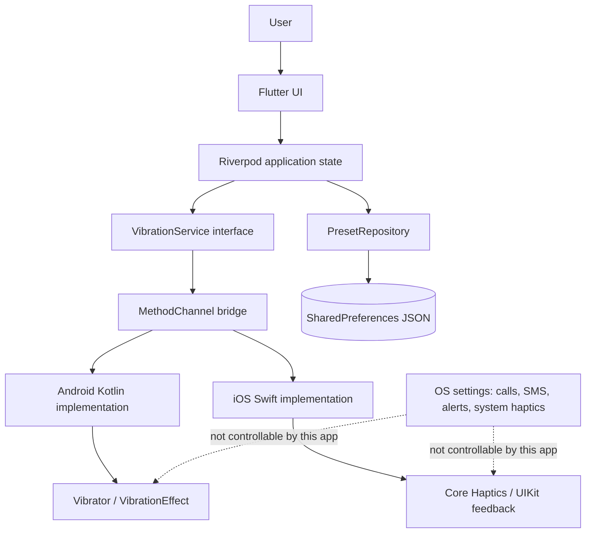

# Vibration Control — Planning Deliverable

> **Status:** Approved 2026-10-30. See `docs/PROGRESS.md` for current implementation status.  
> **Prepared:** 2026-10-30  
> **Scope:** Flutter application for Android and iOS that controls, customizes, and tests haptics generated by the application itself.
>
> **2026-11-01 update:** A paired remote-haptics mode was added. It uses an ephemeral WebSocket relay with a six-digit room code and explicit host approval. Local features remain offline; references below to "no backend/network" apply to local mode only.

Technical claims were checked against Android, Apple, and Flutter documentation during this planning session. Third-party package behaviour is treated as a claim until verified on real hardware.

---

## 0. Decision Summary

- The product is feasible as an **in-app haptics laboratory**.
- It is **not** a system-wide vibration controller.
- Android has the strongest public API surface for duration, patterns, amplitude, and cancellation.
- iOS has rich custom haptics through Core Haptics on supported iPhones, but no access to system-wide vibration settings and no background playback.
- Flutter's built-in haptics are insufficient for the core feature. A native bridge is required.
- Recommended MVP: capability detection, safe test pulse, duration control, graph-based output-strength control where supported, three built-in presets, local save/load, capability and limitation guidance in Settings, automated tests, and physical-device validation.
- The full custom pattern editor should be **MVP+**, not the first MVP.
- The biggest product decision is accepting that "adjust vibration" means **adjust haptics generated by this app**, not the phone's global vibration behaviour.

---

## 1. Executive Summary

The application can let a user adjust the strength of vibration effects generated by the app, test the result, and save a preferred configuration. This directly addresses the central use case only within the app's own effects.

It cannot, through ordinary public APIs, let a user change:

- system-wide vibration intensity;
- vibration strength for incoming calls, SMS, alarms, or third-party apps;
- another app's haptics;
- the physical motor beyond its hardware maximum.

Android provides the richest public API surface, including per-segment amplitude on devices that report amplitude control. iOS provides expressive Core Haptics on supported iPhones, including normalized intensity and sharpness, but no system-wide settings access. Both platforms may scale, suppress, or reinterpret requests based on device hardware, system settings, and OS policy.

The recommended MVP is intentionally small. It proves the central idea without pretending to solve system-wide vibration control. A full pattern editor, sharing, advanced diagnostics, and OEM integrations are deferred until the core experience is stable.

### 1.1 Assumptions used for this plan

- One developer with backend experience and some Flutter knowledge.
- Flutter stable will be used.
- An Android physical device is available.
- macOS, Xcode, and a physical iPhone 8+ are available for later iOS work.
- No design system or brand identity is assumed.
- English-only UI for the first MVP.
- Local mode has no backend, accounts, cloud, analytics, AI, or advertising.
- Remote mode uses a small user-deployed WebSocket relay with no accounts or persisted messages.
- Estimates are planning ranges, not guarantees.
- Publishing immediately is not assumed; internal builds and TestFlight may be sufficient initially.

---

## 2. Product Scope

### 2.1 In scope

- Haptics generated by our application while it is in the foreground.
- Single pulses and simple multi-segment patterns.
- Android amplitude control on supported hardware.
- iOS Core Haptics intensity/sharpness on supported hardware.
- Runtime capability reporting.
- Local presets and settings.
- Clear explanations of platform limitations.
- Accessibility, offline local operation, and privacy.
- Paired remote control of app-generated haptics after explicit host approval.

### 2.2 Out of scope

- Changing Android or iOS global vibration intensity.
- Changing call, SMS, alarm, or third-party notification vibration.
- Controlling another app's haptics.
- Direct motor voltage/frequency control.
- Exceeding the hardware maximum.
- Root, jailbreak, privileged permissions, or hidden OEM APIs.
- Accounts, cloud sync, AI, analytics, or advertising.
- Remote control without host approval, persisted room history, or background haptic automation.
- Background haptic automation or scheduled vibration.
- Notification-channel customization in the MVP.

### 2.3 The five capabilities must not be treated as equivalent

| Capability | Ordinary third-party app? | Notes |
|---|---|---|
| Change amplitude of our own haptic effect | Yes, where supported | Android amplitude; iOS Core Haptics intensity |
| Change system-wide vibration intensity | No | No supported public API on either platform |
| Change call/SMS/alarm/third-party vibration | No | System, privileged, or OEM APIs only |
| Control the physical motor directly | No | Public APIs expose effects, not raw motor drive |
| Exceed hardware maximum | No | APIs are bounded by device capability |

This distinction must appear in the app UI, store description, and documentation.

---

## 3. Phase 1 — Technical Feasibility

### 3.1 Android

**Confirmed behaviour:**

- `Vibrator` and `VibratorManager` expose vibration hardware. From API 31, `VibratorManager.getDefaultVibrator()` is preferred. Older code uses `Vibrator`.
- `Vibrator.hasVibrator()` reports whether a real vibrator is present.
- `Vibrator.hasAmplitudeControl()` reports whether the hardware can vary amplitude.
- `VibrationEffect.createOneShot(durationMs, amplitude)` accepts amplitude **1–255** or `DEFAULT_AMPLITUDE`.
- `VibrationEffect.createWaveform(timings, amplitudes, repeat)` supports multi-segment patterns. Timings alternate **off/on**, and the first timing is an off duration.
- If the device does **not** support amplitude control, non-zero amplitude values are treated as full strength. The app must not silently pass amplitude values and imply control.
- Playing a `VibrationEffect` requires the normal `VIBRATE` manifest permission. It is not a runtime permission flow.
- The app should be in the foreground to vibrate. Background vibration is restricted to attentional usages such as alarm/ringtone/notification.
- `VibrationAttributes` (API 33+) and older `AudioAttributes` classify usage. For an in-app test, `USAGE_TOUCH` or an appropriate foreground feedback usage is more truthful than `USAGE_ALARM`.
- `HapticFeedbackConstants` / `View.performHapticFeedback()` provide platform-consistent UI feedback and do not require `VIBRATE`, but they do not provide arbitrary duration or amplitude.
- Android 16+ documentation describes `VibrationEffect.Builder` with richer composition and automatic fallback. This is optional for the MVP; the stable API 26 waveform path is simpler and more broadly compatible.

**Important restrictions:**

- There is no supported public API for an ordinary app to change global notification vibration intensity.
- `WRITE_SETTINGS` is a special user-granted capability, but it does not provide a reliable, documented, cross-device API for global vibration intensity. Android's documentation for `Settings.System.VIBRATE_ON` states that changing the value internally does not change vibration behaviour.
- OEMs may scale, suppress, or reinterpret amplitude. `hasAmplitudeControl()` is a capability signal, not a guarantee of linear perceived strength.
- Emulators usually cannot reproduce real vibration strength.

### 3.2 iOS

**Confirmed behaviour:**

- Core Haptics is available from iOS 13 and requires haptic-capable hardware, starting with iPhone 8 and later. Apple states that iPad, iPod touch, and Apple Vision Pro do not support Core Haptics haptics.
- `CHHapticEngine.capabilitiesForHardware().supportsHaptics` is the runtime capability check.
- `CHHapticEngine` can play custom patterns made of transient and continuous events.
- `CHHapticEvent` parameters include `hapticIntensity` (0.0–1.0) and `hapticSharpness` (0.0–1.0). These are normalized parameters, not a guarantee of linear perceived strength.
- `CHHapticAdvancedPatternPlayer` supports stopping, pausing, seeking, and looping. Fire-and-forget `playPattern(from:)` cannot be stopped.
- Core Haptics stops the engine when the app is suspended/backgrounded or interrupted, such as by a call. The app must restart the engine before the next playback.
- `UIImpactFeedbackGenerator` and related UIKit generators provide simple system-defined feedback. `impactOccurred(intensity:)` is available from iOS 13 and accepts 0.0–1.0, but it does not provide arbitrary duration or multi-segment patterns.
- The iOS Simulator does not provide a haptic interface. Haptics must be tested on a physical device.

**Important restrictions:**

- There is no documented public API for reading or changing the user's Sounds & Haptics settings, system haptic intensity, or call/SMS/alarm vibration.
- There is no public API for adding custom haptic patterns to notifications in the way Core Haptics works inside a foreground app.
- Background haptic playback is not available for this use case.
- The system can override or suppress haptic requests.
- The iOS app cannot deep-link directly to the Sounds & Haptics settings through a documented public API; it can only guide the user.

### 3.3 Flutter

Flutter's built-in `HapticFeedback` is a convenience API, not a precision API. Its documentation says it is "not suitable for precise control of the system's haptic feedback module."

Examples:

- `HapticFeedback.vibrate()` maps to a long-press-style Android haptic and the system vibration sound on iOS.
- `lightImpact`, `mediumImpact`, and `heavyImpact` map to platform constants/feedback generators.
- There is no duration, amplitude, waveform, or repeat parameter.

A platform bridge is required for the product's core behaviour.

#### Third-party package assessment — `vibration`

The `vibration` package is the best-known option. As of the checked release, version 3.2.1:

- supports Android duration, pattern, intensities, and amplitude;
- supports iOS duration/pattern/intensity on Core Haptics devices;
- falls back to fixed vibration on older iOS devices;
- requires Flutter 3.41.0 / Dart 3.11.0 for the latest release;
- is maintained but effectively single-maintainer and has an unverified pub.dev uploader;
- its Android implementation uses `AudioAttributes.USAGE_ALARM` for all vibrations, which is not appropriate for ordinary in-app haptic testing;
- its iOS implementation catches and prints some failures rather than returning structured errors to Dart;
- its capability reporting is incomplete for a diagnostics-oriented app.

**Recommendation:** Do not make this package the architectural core. It is acceptable only for a short throwaway spike. The production MVP should own a thin native bridge so capability reporting, error handling, cancellation, and platform-specific fallback behaviour are under our control.

### 3.4 Confirmed versus still-to-verify

| Status | Item |
|---|---|
| Confirmed | Android amplitude range, `hasAmplitudeControl`, waveform semantics, `VIBRATE` permission, foreground restriction |
| Confirmed | iOS Core Haptics availability, normalized intensity, engine stoppage in background, simulator limitation |
| Confirmed | No public API for global vibration settings on either platform |
| Confirmed | Flutter built-in haptics lack duration/amplitude/pattern control |
| Needs device verification | Whether iOS Core Haptics is suppressed when "System Haptics" is off |
| Needs device verification | Whether Android OEM skins suppress or scale `USAGE_TOUCH` effects when touch feedback is disabled |
| Needs device verification | Exact perceived response curves across Pixel/Samsung/Xiaomi/etc. |
| Needs device verification | Low Power Mode / battery saver behaviour |
| Needs device verification | iOS silent mode interaction with haptics-only patterns |
| Needs device verification | Behaviour of `vibration` package, if used for a spike, on target devices |

---

## 4. Android and iOS Compatibility Matrix

Legend:

- **FS** — Fully supported through public APIs.
- **SL** — Supported with limitations.
- **DD** — Device-dependent.
- **RNI** — Requires native implementation.
- **RSP** — Requires special permissions or privileged access.
- **NA** — Not available to ordinary third-party applications.

| Capability | Android | iOS | Flutter route | Overall label |
|---|---|---|---|---|
| Detect vibration actuator | FS, DD | SL | Native bridge | FS Android / SL iOS |
| Detect amplitude/intensity capability | FS via `hasAmplitudeControl()` | No equivalent "amplitude" capability; `supportsHaptics` plus parameter attributes | Native bridge | DD |
| Fixed-duration vibration | FS via `VibrationEffect` | SL via Core Haptics continuous events; fixed vibration fallback | Native bridge | SL overall |
| Amplitude/intensity adjustment | SL, DD; 1–255 if supported | SL, DD; Core Haptics intensity 0–1 on supported iPhones | Native bridge | DD |
| Custom multi-segment patterns | FS/SL; waveform timings and amplitudes; amplitude requires hardware support | SL; Core Haptics events; no custom patterns on unsupported devices | Native bridge | SL overall |
| Stop/cancel | FS via `Vibrator.cancel()` | SL via advanced player/engine stop | Native bridge | SL overall |
| Predefined/system haptics | FS, API 29+ for predefined effects | FS via UIKit feedback generators | Built-in Flutter / native | DD |
| UI control haptic feedback | FS; `HapticFeedbackConstants` | FS; UIKit generators | Flutter `HapticFeedback` | FS, DD |
| Vibration for our own notifications | SL; own notification channel only; user settings apply | NA; no custom notification haptics | Native Android only | SL Android / NA iOS |
| Call/SMS/alarm/third-party vibration | NA | NA | None | NA |
| Global system vibration intensity | NA | NA | None | NA |
| Direct motor control / overdrive | NA; root/privileged only | NA | None | NA |
| Background haptic playback | SL; only attentional usages, not appropriate for this app | NA; engine suspends | None | NA/SL |
| Read user haptic/vibration settings | Partial/SL; deprecated touch key, OEM differences | NA; no public API | Native, best effort | SL Android / NA iOS |
| Save/load presets locally | FS | FS | Flutter | FS |
| Import/export presets | FS locally; sharing UI | FS locally; sharing UI | Flutter file APIs | FS, post-MVP |
| Device compatibility report | SL; runtime checks only | SL; `supportsHaptics` and parameter attributes | Native bridge | SL |

**Interpretation:** "Supported" always means "supported for effects generated by this app." It never means system-wide control.

---

## 5. Phase 3 — MVP Definition

### 5.1 Recommended MVP

The MVP should prove one thing: **a user can adjust the strength of an app-generated vibration, test it, and save a preferred configuration.**

#### MVP feature decisions

| # | Feature | Purpose / why MVP | Dependencies | Difficulty | Acceptance criteria | Known limitations |
|---|---|---|---|---|---|---|
| 1 | Flutter project setup | Foundation for all work | Toolchain | Low | App builds and runs on Android; iOS build if Mac available | Windows cannot build iOS |
| 2 | Runtime capability detection | Prevent false promises | Native bridge | Medium | Reports actuator, amplitude/intensity support, custom-pattern support, stop support, platform, OS; reports "unknown" where appropriate | Cannot guarantee OEM behaviour |
| 3 | Test button | Proves core value | Native playback | Low–Medium | Plays safe default pulse; stop works; unsupported state is explained | Emulator cannot validate strength |
| 4 | Duration control | Basic customization | Test button | Low | User can set a bounded duration; invalid values rejected | Very short/long effects may feel different than expected |
| 5 | Graph intensity/output control | Central use case | Capability detection | Medium | Graph control only active when supported; Android maps to 1–255; iOS maps to 0–1; unsupported devices show explanation and predictable fallback | Percentage is not perceived loudness |
| 6 | Built-in presets | Fast comparison | Playback | Low | Soft/Normal/Strong plus one simple two-pulse preset play correctly | Hardware response varies |
| 7 | Local save/load/delete | Makes preferences useful | Persistence | Low | Saved preset survives restart; invalid data does not crash app | Local only; uninstall deletes data |
| 8 | Capability/limitation guidance in Settings | Product honesty | Capability + docs | Low | Clearly lists what app can and cannot control; explains system settings | Some settings cannot be read |
| 9 | Automated tests | Prevent regressions | Architecture | Medium | Unit tests for validation/mapping; widget tests for screens; analyzer clean | Native haptics need physical tests |
| 10 | Real-device testing | Validate actual haptics | Devices | Medium | Tested on at least one amplitude-capable Android device and one non-amplitude device; iPhone Core Haptics device if available | Device availability may block iOS |

#### Basic patterns in the MVP

The MVP should include **built-in pattern playback**:

- single short pulse;
- double pulse;
- optionally a three-pulse "alert" pattern.

It should **not** include a full user-authored pattern editor. That is deferred to MVP+.

### 5.2 Explicitly deferred

- Full multi-segment pattern editor with per-segment intensity.
- Repeat count / looping / infinite vibration.
- Pattern import/export/sharing.
- Advanced diagnostics: frequency, primitives, envelope support, sharpness curves.
- OEM-specific integrations.
- Notification-channel customization.
- Background automation, scheduling, or Tasker-style integrations.
- Cloud sync, accounts, analytics, AI, and social features. The paired remote relay is the only approved network service.
- Localization beyond the initial language.
- Custom themes.
- Calibration wizard.
- Home-screen widgets or quick-settings tiles.

### 5.3 MVP non-goals

- Replacing the system Sounds & Haptics settings.
- Making every phone vibrate "harder."
- Controlling third-party notifications.
- Guaranteeing a linear relationship between the strength control and perceived strength.

---

## 6. Phase 2 — Requirements Specification

### 6.1 Functional requirements

| ID | Requirement | Acceptance criteria |
|---|---|---|
| FR-01 | Detect and display device haptic capabilities | Screen shows actuator availability, amplitude/intensity support, custom-pattern support, stop support, platform, and OS; no unsupported capability is reported as guaranteed |
| FR-02 | Play a safe test pulse | Default pulse is short and moderate; playback can be stopped; unsupported hardware produces a clear message |
| FR-03 | Configure duration | Graph hold time controls the live pulse up to 5000 ms; chips select Play test and saved-preset length; invalid values are rejected or prevented |
| FR-04 | Configure requested output strength | Home's graph control adjusts app-generated amplitude/intensity where supported; on unsupported devices the control is disabled or clearly explained |
| FR-05 | Stop playback | Stop button cancels active vibration where the platform supports it; UI returns to idle |
| FR-06 | Play built-in presets | Presets produce the documented effect on supported devices |
| FR-07 | Save, load, rename, delete user presets | Changes persist across restart; deletion is confirmed; invalid stored data is handled safely |
| FR-08 | Explain platform limitations | Settings explains app-generated vs system-wide control, call/SMS/alarm restrictions, and hardware variability |
| FR-09 | Settings | User can set duration/strength on Home, disable app haptics in Settings, and reset local data |
| FR-10 | Error feedback | Unsupported, unavailable, busy, interrupted, and invalid-input states produce actionable messages |
| FR-11 | Lifecycle handling | Playback stops when app is backgrounded; returning to foreground restores a usable state |
| FR-12 | Accessibility | Controls have semantic labels, adequate touch targets, contrast, and non-haptic equivalents for information |
| FR-13 | Offline operation | Core local functionality works in airplane mode; remote pairing requires a relay |
| FR-14 | Bounded playback | Duration, segment count, repeat count, and total pattern length are capped; no infinite loop in MVP |
| FR-15 | Platform difference disclosure | UI states when a feature is Android-only, iOS-only, or device-dependent |

### 6.2 Nonfunctional requirements

| Area | Requirement |
|---|---|
| Offline | Local features work without internet. Remote pairing requires a relay URL but no account or cloud sync. |
| Startup | Cold start target under 2 seconds on a mid-range test device; capability load must not block first frame unnecessarily. |
| Battery | No background polling, wakelocks, or continuous vibration. Haptic engine/player stops when idle. |
| Reliability | Unsupported hardware, missing capability, invalid input, rapid taps, and lifecycle changes must not crash the app. |
| Accessibility | Screen-reader labels, 48dp minimum targets, contrast, scalable text, and no information conveyed by haptics alone. |
| Privacy | No PII, analytics SDK, or advertising. Network calls occur only for a user-started remote session and are not persisted. |
| Maintainability | Thin native bridge, typed errors, unit/widget tests, lint clean, documented decisions. |
| Cross-platform | Shared Flutter UI; platform differences isolated behind one service interface. |
| Error handling | Native errors are mapped to typed Dart errors; user-facing messages are actionable. |
| Testing | Unit, widget, integration, and physical-device tests. Emulator tests are not accepted as proof of haptic strength. |
| Device testing | At least two Android devices with different amplitude capabilities; one Core Haptics iPhone if available. |

---

## 7. Recommended Technology Stack

| Layer | Choice | Reason |
|---|---|---|
| UI | Flutter stable, Material 3 | Shared UI, fast iteration |
| State management | Riverpod, without code generation | Testable dependency injection, async capability loading, no `BuildContext` dependency for services |
| Local storage | `shared_preferences` with versioned JSON | Small data volume; no relational queries; simple migration path |
| Native bridge | `MethodChannel` | Only a few operations; Pigeon is optional later |
| Android | Kotlin, `VibratorManager`/`Vibrator`, `VibrationEffect` | Official APIs; direct control over fallback |
| iOS | Swift, Core Haptics, UIKit feedback generators | Official APIs; control over engine lifecycle |
| IDs | UUID | Stable preset identifiers |
| Testing | `flutter_test`, `integration_test`, `mocktail` or fakes | Unit/widget/integration coverage |
| Lint | `flutter_lints` | Standard Flutter checks |
| Backend | Node.js WebSocket relay | Ephemeral paired remote haptics only |
| Analytics | None | Privacy and scope |

Do not add packages until each one is justified in `DECISIONS.md`.

---

## 8. Phase 4 — Technical Architecture

### 8.1 Principles

- Keep the UI dumb: no direct platform calls from widgets.
- One narrow native contract for all haptics.
- Model platform differences explicitly; do not hide them behind a false "works everywhere" API.
- No full domain/use-case hierarchy for this app size.
- Keep the native bridge small enough to test and replace.

### 8.2 State management decision

| Option | Assessment |
|---|---|
| `setState` only | Too limited for shared capability, preset, and playback state |
| Provider + `ChangeNotifier` | Workable, but manual dependency wiring becomes noisy |
| Riverpod | Recommended: testable, async-friendly, good for injecting fake services, no codegen required |
| Bloc | Capable but heavier ceremony than this app needs |

**Recommendation:** Riverpod with a small number of controllers:

- `CapabilityController`
- `SettingsController`
- `PresetController`
- `PlaybackController`

Do not use Riverpod code generation for the MVP.

### 8.3 Domain layer

A separate domain layer is **justified but minimal**:

- immutable models;
- pure validation functions;
- service interfaces;
- platform-neutral request/result types.

Do not create one "use case" class per button. The application layer can orchestrate directly.

### 8.4 Native integration decision

| Approach | Assessment |
|---|---|
| Flutter `HapticFeedback` | Insufficient: no duration, amplitude, or patterns |
| `vibration` package | Good for a spike; not ideal as production core due to error swallowing, usage classification, and capability-reporting limitations |
| `MethodChannel` | Recommended for MVP: simple, explicit, easy to validate |
| Pigeon | Better type safety, but adds codegen/build complexity; adopt only if the contract grows |
| Direct Kotlin/Swift | Required regardless for the core feature |

**Recommendation:** One MethodChannel named, for example, `vibration_control/haptics`, with a versioned contract. The native layer owns capability reporting, playback, cancellation, and platform-specific fallback.

### 8.5 Conceptual native contract

No implementation code is implied by these signatures.

| Operation | Input | Success output | Failure |
|---|---|---|---|
| `getCapabilities` | none | platform, OS, has actuator, amplitude/intensity support, custom-pattern support, stop support, Core Haptics support, legacy vibration support, warnings | typed error if bridge unavailable |
| `play` | request ID, segments, repeat count | started, effective mode (`amplitude`, `onOff`, `fixed`, `unsupported`), warnings | `NO_VIBRATOR`, `UNSUPPORTED`, `INVALID_ARGUMENT`, `BUSY`, `INTERRUPTED`, `PLATFORM_ERROR` |
| `stop` | request ID or active session | stopped/not-playing | `PLATFORM_ERROR` |

**Rules:**

- Flutter and native both validate input.
- One active playback session at a time.
- A new request either cancels the current one or returns `BUSY`; the chosen behaviour must be consistent and documented.
- For MVP test UX, I recommend: a new user-initiated test cancels the previous test, while the UI debounces rapid taps.
- Native errors must be returned to Dart, not only printed.
- Never claim success when the native layer fell back to a different effect; return the effective mode and warnings.
- Apply a short timeout to bridge calls so a native failure does not leave the UI stuck; stop must still be attempted.

### 8.6 Local persistence decision

| Option | Assessment |
|---|---|
| `shared_preferences` + JSON | Recommended: sufficient for settings and tens of presets; simple, offline, low ceremony |
| SQLite / drift | Overkill for MVP; useful only if presets become numerous or queryable |
| Hive / Isar | Extra dependency for little benefit here |
| Raw files | Useful for import/export, not needed as primary store |
| Secure storage | Not needed; no secrets |

**Recommendation:** Store one versioned JSON envelope under one key:

```text
{ schemaVersion, settings, presets }
```

- Validate after load.
- If the version is unknown, preserve the raw value and show a recovery message; do not silently wipe user data.
- Built-in presets live in code, not persisted storage.
- User presets are stored separately and can be deleted.
- Add schema migration when the model changes.

### 8.7 Architecture diagram



The diagram deliberately separates the local persistence path and the system-controlled settings path.

---

## 9. Phase 5 — Proposed Flutter Project Structure

```text
lib/
  main.dart
  app.dart
  core/
    config/
    errors/
    theme/
    utils/
  domain/
    models/
      vibration_preset.dart
      vibration_segment.dart
      capability_report.dart
      playback_result.dart
      app_settings.dart
    validation/
      vibration_validator.dart
    services/
      vibration_service.dart
      remote_control_service.dart
      websocket_remote_control_service.dart
    remote/
      remote_models.dart
      remote_config.dart
      remote_validator.dart
  application/
    providers/
    controllers/
      capability_controller.dart
      playback_controller.dart
      preset_controller.dart
      settings_controller.dart
      remote_controller.dart
  data/
    local/
      preferences_store.dart
    repositories/
      preset_repository.dart
      settings_repository.dart
  platform/
    haptics/
      method_channel_vibration_service.dart
      haptics_contract.dart
  pages/
    home_page.dart
    remote_page.dart
    settings_page.dart
    pattern_editor_page.dart  # post-MVP
  widgets/
    app_widgets.dart
    preset_tile.dart
    vibration_graph.dart
android/app/src/main/kotlin/<package>/
  MainActivity.kt
  haptics/
    HapticsPlugin.kt
ios/Runner/
  AppDelegate.swift
  HapticsPlugin.swift
relay/
  server.js
  tests/relay.test.js
  Dockerfile
test/
  unit/
  widget/
integration_test/
docs/
```

| Path | Responsibility | MVP? |
|---|---|---|
| `lib/main.dart` | Entry point, provider scope, bootstrap | Yes |
| `lib/app.dart` | Material app, theme, navigation | Yes |
| `core/errors` | Typed app errors and user-safe messages | Yes |
| `domain/models` | Immutable data models | Yes |
| `domain/validation` | Pure validation rules | Yes |
| `domain/services` | Service interfaces | Yes |
| `application/controllers` | Orchestration and state transitions | Yes |
| `data/local` | SharedPreferences implementation | Yes |
| `data/repositories` | Storage abstraction and mapping | Yes |
| `platform/haptics` | MethodChannel adapter and contract constants | Yes |
| `pages/*` | App pages and page-specific widgets | Yes |
| `widgets/app_widgets.dart` | Reusable accessible widgets | Yes |
| `pages/pattern_editor_page.dart` | Full editor | Post-MVP |
| Native Android/iOS files | Capability, playback, stop | Yes |
| `test`, `integration_test` | Automated tests | Yes |
| `docs` | Planning and maintenance documents | Yes |

**Native code placement:** Keep native code app-local for the MVP. Extract it into a Flutter plugin package only if it is reused elsewhere or needs independent versioning.

---

## 10. Phase 7 — Data Models and Contracts

### 10.1 Proposed models

**VibrationSegment**

| Field | Type | Required | Notes |
|---|---|---|---|
| `vibrationMs` | integer | Yes | 20–5000 ms; no zero-length vibration |
| `pauseAfterMs` | integer | Yes | 0–5000 ms |
| `strengthPercent` | integer | Yes | 1–100; platform-neutral requested output |

**VibrationPreset**

| Field | Type | Required | Notes |
|---|---|---|---|
| `id` | string | Yes | UUID |
| `name` | string | Yes | 1–40 characters after trim |
| `segments` | list | Yes | 1–10 segments |
| `repeatCount` | integer | Yes | 1–5; no infinite repeat |
| `createdOnPlatform` | enum | No | Metadata only; must not gate compatibility |
| `updatedAt` | ISO-8601 string | No | Useful for sorting; not essential for first MVP |

**AppSettings**

| Field | Type | Required | Notes |
|---|---|---|---|
| `defaultDurationMs` | integer | Yes | Safe default: 300 ms |
| `defaultStrengthPercent` | integer | Yes | Safe default: 50 |
| `selectedPresetId` | string / null | No | Last selected user preset |
| `appHapticsEnabled` | boolean | Yes | App-level switch, not system setting |

**CapabilityReport**

| Field | Type | Notes |
|---|---|---|
| `platform` | Android/iOS | Runtime |
| `osVersion` | string | Display/diagnostics |
| `hasActuator` | boolean | `hasVibrator` / `supportsHaptics` |
| `supportsAmplitude` | boolean | Android hardware capability |
| `supportsIntensity` | boolean | iOS Core Haptics intensity |
| `supportsCustomPatterns` | boolean | Derived, not assumed from OS version |
| `supportsStop` | boolean | True when advanced player/stop is available |
| `supportsCoreHaptics` | boolean | iOS only |
| `supportsLegacyVibration` | boolean | iOS fallback |
| `warnings` | list of strings | Known limitations |

**PlaybackResult**

| Field | Type | Notes |
|---|---|---|
| `started` | boolean | Whether playback started |
| `effectiveMode` | enum | `amplitude`, `onOff`, `fixed`, `unsupported` |
| `warnings` | list of strings | Fallbacks and caveats |
| `errorCode` | enum / null | Structured failure |
| `requestId` | string | Stale-result protection |

### 10.2 Validation rules

| Rule | Value |
|---|---|
| Vibration duration | 20–5000 ms |
| Pause after segment | 0–5000 ms |
| Segments per preset | 1–10 |
| Repeat count | 1–5 |
| Total pattern duration | ≤ 30 seconds including pauses and repeats |
| Strength | 1–100% |
| Preset name | 1–40 characters after trim |
| User presets | Maximum 50 for MVP |
| Infinite repeat | Not allowed |
| NaN/Infinity | Rejected |
| Android amplitude mapping | `round(percent × 255 / 100)`, clamp 1–255, only when supported |
| iOS intensity mapping | `percent / 100`, 0.01–1.0 |
| Unsupported amplitude | Do not silently send amplitude; use on/off fallback or disable the control |

### 10.3 Schema versioning

- One envelope with `schemaVersion`.
- Current version: `1`.
- Migration runs on load.
- Unknown future version: preserve raw data, show a safe error, do not erase.
- User data is local-only; uninstall removes it.
- Import/export is deferred, but the JSON envelope should be export-ready.

### 10.4 Service contracts

Conceptual only:

- `getCapabilities() → CapabilityReport`
- `play(VibrationRequest) → PlaybackResult`
- `stop() → StopResult`
- `loadSettings() → AppSettings`
- `saveSettings(AppSettings) → void`
- `loadPresets() → List<VibrationPreset>`
- `savePreset(VibrationPreset) → void`
- `deletePreset(String id) → void`

Remote mode uses a WebSocket relay with create, join, approve/decline, haptic, status, and leave messages. It requires host approval and does not expose a general-purpose remote API.

---

## 11. UI Screen Inventory

| Screen | MVP? | Contents |
|---|---|---|
| Home | Yes | Hold-to-vibrate graph strength control, duration chips, save preset, built-in and saved presets, active remote-session banner |
| Remote | Yes | Host/control pairing, room code, host approval, live remote graph, session status and end |
| Settings | Yes | App haptics toggle, capability report, limitations, reset data, privacy/about |
| Pattern Editor | Post-MVP | Segments, preview, repeat, save |
| Onboarding | Optional | One-time explanation of app-only scope and safety |
| Preset Import/Export | Post-MVP | File-based sharing with capability warnings |

**Recommendation:** Keep the core loop on Home: strength, duration, preview, preset library, and save in one place. Put capability details and limitations in Settings.

Suggested navigation: Home, Remote, Settings.

---

## 12. Phase 6 — Development Roadmap

### 12.1 Effort summary

| Stage | Estimate (development days) |
|---|---|
| 1. Feasibility and requirements | 1–2 |
| 2. Environment | 0.5–1.5 Android; +0.5–1 iOS |
| 3. Project initialization | 0.5 |
| 4. UI and navigation | 2–3 |
| 5. Capability detection | 2–4 |
| 6. Basic vibration | 1–2 |
| 7. Intensity adjustment | 2–3 |
| 8. Custom patterns (post-MVP) | 4–6 |
| 9. Local persistence | 1–2 |
| 10. Testing and reliability | 3–5 |
| 11. Security and privacy review | 0.5–1 |
| 12. Release preparation | 2–4 Android; +2–3 iOS |
| 13. Future enhancements | Not estimated |

Assumptions: one developer, existing Flutter familiarity, one Android device, Mac/iPhone available for iOS, no custom visual design, no store-review delays. These are ranges, not guarantees.

**Approximate MVP total:** 15–29 development days, plus buffer; plan for 20–35 days.  
**Android-only MVP without iOS validation:** roughly 10–20 days.  
**Full roadmap including the pattern editor and both platforms:** roughly 24–40 days, plus store review.

### Stage 1 — Product feasibility and requirements

- **Objective:** Freeze product scope, verify platform restrictions, and produce the requirements baseline.
- **Why:** Prevents the project from chasing impossible system-wide vibration control.
- **Prerequisites:** The resolved decisions in Section 19; access to at least one Android device; macOS, Xcode, and a physical iPhone 8+ available for later iOS work.
- **Exact tasks:** Confirm in/out-of-scope features; confirm target OS versions; record capability matrix; define MVP acceptance criteria; create the initial documentation set; record confirmed restrictions and open risks.
- **Files/components:** `PROJECT_REQUIREMENTS.md`, `PLATFORM_LIMITATIONS.md`, `TECHNICAL_ARCHITECTURE.md`, `DEVELOPMENT_ROADMAP.md`, `DECISIONS.md`.
- **Tools/commands:** Markdown editor, official Android/Apple/Flutter documentation, physical Android device for manual settings checks.
- **Implementation decisions:** App-generated haptics only; Android 8+/iOS 13+ as proposed minimums; custom pattern editor deferred from MVP.
- **Testing procedure:** Manually verify device capability indicators and system settings behaviour; document results.
- **Acceptance criteria:** Scope is approved; MVP and deferred features are explicit; no unresolved contradiction about system-wide control.
- **Potential problems:** Ambiguous product expectations; OEM differences; lack of iOS hardware.
- **Troubleshooting:** Reframe impossible features as guidance/shortcuts rather than control; mark unverified claims as tests.
- **Deliverables:** Requirements, feasibility report, compatibility matrix, MVP definition.
- **Definition of done:** Documents reviewed and approved; decisions recorded or explicitly deferred.
- **Exit gate:** User explicitly approves planning and Stage 2.

### Stage 2 — Development environment

- **Objective:** Prepare a reliable build and test environment.
- **Why:** Native code, signing, and physical-device testing require correct tooling.
- **Prerequisites:** Stage 1 approval; administrator access to the development machine.
- **Exact tasks:** Install Flutter stable and Dart; Android Studio and Android SDK; JDK; emulator; Android physical device with USB debugging; Git; on macOS, Xcode and iOS simulator; Apple developer signing as needed; create a device test log.
- **Files/components:** Environment notes; no application files yet.
- **Tools/commands:** Flutter CLI (doctor, version, devices), Android Studio SDK Manager, Xcode, Git, adb/device tools.
- **Implementation decisions:** Pin Flutter version in documentation; do not rely on the latest unpinned toolchain.
- **Testing procedure:** Run Flutter doctor; build and run a minimal sample; install on a physical Android device; build to an iOS simulator/device if available.
- **Acceptance criteria:** Toolchain reports healthy; sample app installs and launches; physical Android device is detected; iOS build path is either working or explicitly blocked.
- **Potential problems:** Missing licenses, USB driver issues, Gradle/JDK mismatch, no macOS, code-signing failures.
- **Troubleshooting:** Accept SDK licenses; reinstall platform tools; verify USB debugging; use a macOS CI only for build checks, not haptic validation.
- **Deliverables:** Environment checklist and device inventory.
- **Definition of done:** Reproducible build steps documented.
- **Exit gate:** Build environment is usable; iOS limitation is recorded if no Mac/iPhone.

### Stage 3 — Flutter project initialization

- **Objective:** Create a clean, minimal application baseline.
- **Why:** Establishes package identity, platform minimums, dependencies, and test structure.
- **Prerequisites:** Stage 2 complete.
- **Exact tasks:** Create the Flutter project with the chosen organization/package ID; set Android minSdk 26 and iOS 13.0; add only approved dependencies; configure lints; create folder skeleton; initialize Git; add a smoke test.
- **Files/components:** `pubspec.yaml`, Android Gradle files, iOS project settings, `lib/main.dart`, `lib/app.dart`, `test/`, `.gitignore`.
- **Tools/commands:** Flutter CLI (create, pub get, analyze, test), Git.
- **Implementation decisions:** Riverpod; SharedPreferences; MethodChannel; Material 3; optional WebSocket relay for remote mode.
- **Testing procedure:** Run analyzer and smoke test; launch on Android; build iOS if possible.
- **Acceptance criteria:** Project builds; tests pass; no unnecessary permissions; package name is correct.
- **Potential problems:** Wrong organization ID; iOS pod/Swift package issues; Gradle version mismatch.
- **Troubleshooting:** Recreate with correct org; clean build; resolve platform toolchain using official migration guidance.
- **Deliverables:** Baseline repository.
- **Definition of done:** Clean build and test on the primary platform.
- **Exit gate:** Baseline accepted; no feature code beyond scaffolding.

### Stage 4 — UI and navigation

- **Objective:** Build the pages and navigation using a fake haptics service.
- **Why:** Validates UX, accessibility, and state transitions before native complexity.
- **Prerequisites:** Stage 3.
- **Exact tasks:** Implement Home, Remote, and Settings; hold-to-vibrate graph; reusable widgets; loading/empty/error/unsupported states; accessible semantics; fake local and remote services for UI tests.
- **Files/components:** `lib/pages/*`, `lib/widgets/*`, `lib/app.dart`, theme, widget tests.
- **Tools/commands:** Flutter CLI (analyze, test), Android emulator/device, iOS simulator if available.
- **Implementation decisions:** Home owns the core loop and preset creation; Settings owns capability details and limitations; bottom navigation; no native calls from widgets.
- **Testing procedure:** Widget tests for navigation, graph interaction, preset saving, and states; manual TalkBack/VoiceOver pass; large-text and contrast check.
- **Acceptance criteria:** All MVP pages reachable; fake states behave correctly; no layout overflow; accessibility labels present.
- **Potential problems:** Overly complex navigation; inaccessible graph control; small touch targets.
- **Troubleshooting:** Simplify navigation; use semantic labels and larger targets; test with system font scaling.
- **Deliverables:** Interactive UI prototype with fake data.
- **Definition of done:** UI works end-to-end without real haptics.
- **Exit gate:** User approves the UX direction.

### Stage 5 — Native capability detection

- **Objective:** Implement the platform bridge for capability reporting.
- **Why:** The app must not promise features the device or OS cannot support.
- **Prerequisites:** Stage 4; Android/iOS native toolchain.
- **Exact tasks:** Create MethodChannel; Android Kotlin capability implementation using `VibratorManager` with fallback; iOS Swift implementation using Core Haptics; map native data to `CapabilityReport`; handle bridge errors; add tests.
- **Files/components:** `lib/platform/haptics/*`, `android/.../HapticsPlugin.kt`, `ios/Runner/HapticsPlugin.swift`, native registration, tests.
- **Tools/commands:** Android Studio, Xcode, Flutter CLI (test, build), physical devices.
- **Implementation decisions:** MethodChannel over Pigeon for MVP; no amplitude claim from OS version alone; report unknown where needed.
- **Testing procedure:** Unit-test Dart mapping with fakes; run on emulator (no hardware), physical Android, iPhone if available.
- **Acceptance criteria:** Correct capability report on all test devices; bridge failure produces a typed error; no crash on unsupported hardware.
- **Potential problems:** Plugin not registered; channel name mismatch; iOS simulator reports no haptics; iPad reports false.
- **Troubleshooting:** Check MainActivity/AppDelegate registration; rebuild clean; inspect logs; verify `supportsHaptics`.
- **Deliverables:** Functional Settings capability report backed by real capability data.
- **Definition of done:** Capability report is truthful and tested.
- **Exit gate:** No false-positive capability is observed.

### Stage 6 — Basic vibration testing

- **Objective:** Implement the first real vibration playback.
- **Why:** Proves the core action works on real hardware.
- **Prerequisites:** Stage 5.
- **Exact tasks:** Implement one-shot playback; duration validation; safe defaults; stop; error mapping; debounce rapid taps; stop on background; native input validation.
- **Files/components:** `VibrationService`, `PlaybackController`, Home playback UI, native play/stop, tests.
- **Tools/commands:** Flutter CLI (test), Android/iOS physical devices.
- **Implementation decisions:** Default 300 ms; max 5 s per segment; no background playback; one active session.
- **Testing procedure:** Unit tests for validation; widget tests for states; physical playback and stop; rapid-tap test; unsupported-hardware test.
- **Acceptance criteria:** Test button plays on supported devices; stop cancels; unsupported device shows a clear message; no crash on rapid taps.
- **Potential problems:** Emulator cannot vibrate; missing VIBRATE permission; app not foreground; OEM suppression.
- **Troubleshooting:** Test on physical hardware; verify manifest permission; keep app foreground; check device sound/haptic settings.
- **Deliverables:** Working test pulse.
- **Definition of done:** Core play/stop loop is reliable on at least one physical device.
- **Exit gate:** User approves basic haptic behaviour.

### Stage 7 — Intensity adjustment

- **Objective:** Add the graph-style output-strength control and platform mapping.
- **Why:** This is the central product use case.
- **Prerequisites:** Stage 6; at least one amplitude-capable Android device; Core Haptics iPhone if iOS is in scope.
- **Exact tasks:** Add graph control; map percent to Android amplitude and iOS intensity; gate by capability; implement on/off fallback; show effective mode and warnings; log requested vs effective values.
- **Files/components:** Home strength graph, controller, native mapping, tests, capability text.
- **Tools/commands:** Flutter CLI (test), physical devices with and without amplitude control.
- **Implementation decisions:** Label as "app output level", not system vibration; no claim of linear perceived strength; disable or explain unsupported control.
- **Testing procedure:** Physical A/B across values; verify logs; test unsupported device; test system touch-haptics off; test low power if possible.
- **Acceptance criteria:** The graph control changes the effect on supported devices; unsupported devices do not silently vibrate at max; UI explains the difference.
- **Potential problems:** No perceptible change; OEM scaling; system settings suppress haptics; iOS System Haptics disabled.
- **Troubleshooting:** Confirm `hasAmplitudeControl`; use appropriate usage attributes; test on multiple devices; add user-facing guidance.
- **Deliverables:** Intensity-adjusted test effect.
- **Definition of done:** Supported/unsupported behaviour is explicit and verified.
- **Exit gate:** No misleading percentage claim remains.

### Stage 8 — Custom patterns (post-MVP / MVP+)

- **Objective:** Implement user-authored multi-segment patterns.
- **Why:** Adds expressive customization after the core intensity loop is stable.
- **Prerequisites:** Stages 4–7; persistence may be developed in parallel but should follow data model approval.
- **Exact tasks:** Implement segment editor; preview; repeat count; validation; Android waveform conversion; iOS Core Haptics events; stop/overlap handling; save/delete.
- **Files/components:** `pages/pattern_editor_page.dart`, models, native pattern playback, tests.
- **Tools/commands:** Flutter CLI, physical devices.
- **Implementation decisions:** Max 10 segments; max 5 repeats; no infinite loop; use advanced iOS player for stop.
- **Testing procedure:** Unit tests for conversion; widget tests for editor; physical playback; rapid edit/preview; background interruption.
- **Acceptance criteria:** User can create, preview, save, and stop a pattern; no overlapping playback; platform differences are explained.
- **Potential problems:** iOS pattern has no playable events; Android timing starts with off; engine stops; patterns feel different across platforms.
- **Troubleshooting:** Ensure non-zero intensities and positive durations; prepend Android off timing; keep app foreground; restart iOS engine.
- **Deliverables:** Pattern editor and playback.
- **Definition of done:** Pattern feature works on both available platforms or is explicitly Android-only.
- **Exit gate:** MVP+ scope approved.

### Stage 9 — Local persistence

- **Objective:** Save and load settings and presets locally.
- **Why:** Makes user preferences durable without a backend.
- **Prerequisites:** Stage 7; stable model definitions.
- **Exact tasks:** Implement SharedPreferences JSON envelope; repositories; CRUD; schema version; migration; corruption handling; tests.
- **Files/components:** `data/local`, `data/repositories`, models, tests.
- **Tools/commands:** Flutter CLI (test), app restart testing.
- **Implementation decisions:** SharedPreferences over SQLite; one JSON key; built-in presets in code.
- **Testing procedure:** Save, restart, load, rename, delete; corrupt JSON; unknown schema version; storage limits.
- **Acceptance criteria:** Data survives restart; invalid data does not crash; no silent data wipe.
- **Potential problems:** JSON corruption; platform storage differences; uninstall removes data.
- **Troubleshooting:** Single-key atomic write; validate before use; preserve raw data on migration failure.
- **Deliverables:** Persistent presets and settings.
- **Definition of done:** Persistence tests pass and are documented.
- **Exit gate:** User data behaviour approved.

### Stage 10 — Testing and reliability

- **Objective:** Harden the MVP across lifecycle, errors, and device variability.
- **Why:** Haptics are hardware-dependent; a successful build is not proof of correct behaviour.
- **Prerequisites:** Stages 5–9.
- **Exact tasks:** Complete unit/widget/integration tests; run device matrix; background/interruption tests; rapid repeated requests; battery/performance checks; accessibility audit; regression pass.
- **Files/components:** `test/`, `integration_test/`, test docs, bug fixes.
- **Tools/commands:** Flutter CLI (test, analyze), Android/iOS devices, profiler, accessibility scanner.
- **Implementation decisions:** Physical-device acceptance required; emulator only for UI.
- **Testing procedure:** Execute the matrix in Section 13; record model/OS/result in a device log.
- **Acceptance criteria:** Automated suite passes; no P0/P1 defects; device matrix signed off.
- **Potential problems:** Flaky tests; limited devices; OEM-specific failures.
- **Troubleshooting:** Isolate platform tests; use fakes for Dart tests; reproduce on multiple physical devices.
- **Deliverables:** Test report and release-candidate confidence.
- **Definition of done:** All MVP acceptance criteria met on real hardware.
- **Exit gate:** No unresolved critical reliability issue.

### Stage 11 — Security and privacy review

- **Objective:** Ensure the app requests only what it needs and collects nothing unnecessary.
- **Why:** The app should be trustworthy and store-friendly.
- **Prerequisites:** Stage 10.
- **Exact tasks:** Audit manifest/plist permissions; verify local offline operation; review the remote relay for WSS, host approval, rate limits, and no persistence; validate all user input; confirm no root/privileged assumptions; review dependency privacy; write privacy notes.
- **Files/components:** Android manifest, iOS Info.plist, dependency list, docs.
- **Tools/commands:** Manifest merger output, dependency audit, airplane-mode test.
- **Implementation decisions:** Only Android `VIBRATE`; no analytics; no accounts; no cloud sync; ephemeral remote relay with host approval.
- **Testing procedure:** Airplane-mode full flow; permission review; invalid-input fuzz tests.
- **Acceptance criteria:** No unnecessary permissions; core works offline; no secrets or PII.
- **Potential problems:** Transitive permissions; debug-only permissions; third-party SDK data collection.
- **Troubleshooting:** Inspect merged release manifest; remove unused dependencies; document any unavoidable permission.
- **Deliverables:** Privacy/security review.
- **Definition of done:** Release build passes the review.
- **Exit gate:** User accepts privacy posture.

### Stage 12 — Release preparation

- **Objective:** Produce a distributable build and store-ready materials.
- **Why:** Converts the validated MVP into something users can install.
- **Prerequisites:** Stage 11; release signing credentials; store accounts if publishing.
- **Exact tasks:** App icon/branding; app name; package/bundle ID; version/build number; Android keystore/signing; iOS signing/provisioning; release builds; store descriptions; screenshots; compatibility disclosures; privacy disclosures; release-device testing.
- **Files/components:** App icons, metadata, build configs, store listing assets, docs.
- **Tools/commands:** Android Studio, Xcode, Play Console, App Store Connect, Flutter release build CLI.
- **Implementation decisions:** Internal APK/TestFlight first; store publishing optional.
- **Testing procedure:** Install release build on clean devices; upgrade test; offline test; permission review; store-preview review.
- **Acceptance criteria:** Signed release build installs; no debug artifacts; metadata truthfully states app-only scope.
- **Potential problems:** Signing/provisioning failures; store review questions; device compatibility gaps.
- **Troubleshooting:** Verify keystore/profile; provide review notes explaining haptics require a physical device; avoid overclaiming.
- **Deliverables:** Release candidate and store materials.
- **Definition of done:** Release candidate passes the MVP acceptance criteria.
- **Exit gate:** User approves distribution target.

### Stage 13 — Future enhancements

- **Objective:** Maintain a prioritized post-MVP backlog.
- **Why:** Prevents scope creep before the MVP is stable.
- **Prerequisites:** Stable MVP and user feedback.
- **Exact tasks:** Evaluate pattern sharing, advanced diagnostics, accessibility improvements, Android 16 composition, iOS AHAP presets, notification-channel customization, and calibration.
- **Files/components:** `DEVELOPMENT_ROADMAP.md`, `PROGRESS.md`, `DECISIONS.md`.
- **Tools/commands:** User feedback, official API documentation, device testing.
- **Implementation decisions:** No OEM reverse-engineering; no privileged APIs; no cloud unless justified.
- **Testing procedure:** Re-run the feasibility checklist for each proposed feature.
- **Acceptance criteria:** Each enhancement has a clear user value and platform feasibility note.
- **Potential problems:** Platform API changes; scope creep; misleading "stronger vibration" promises.
- **Troubleshooting:** Re-check official documentation and test on real hardware before committing.
- **Deliverables:** Prioritized future roadmap.
- **Definition of done:** Backlog approved; no enhancement started without a new plan.
- **Exit gate:** Next release scope approved.

---

## 13. Phase 8 — Testing Strategy

### 13.1 Testing matrix

| # | Scenario | Test type | Expected result |
|---|---|---|---|
| 1 | Android device with amplitude control | Physical | Strength control changes requested amplitude; logs show mapped values; no crash |
| 2 | Android device without amplitude control | Physical | UI explains unsupported amplitude; falls back to on/off or disables control |
| 3 | Android vibration disabled in system settings | Physical | App handles suppression without crashing; guidance is shown |
| 4 | iOS Core Haptics device | Physical iPhone 8+ | Custom pulse/pattern plays; strength control changes intensity |
| 5 | iOS device without Core Haptics | Physical/emulator | Fallback or unsupported message; no false claim |
| 6 | No vibration hardware | Emulator/device | Capability report says unavailable; test disabled |
| 7 | Invalid duration | Unit/widget | Input rejected; no native call |
| 8 | Invalid amplitude | Unit/widget | Input rejected; no out-of-range value |
| 9 | Rapid repeated requests | Integration/physical | UI debounces; last request wins; no overlap/crash |
| 10 | Overlapping requests | Integration/physical | Previous playback stops or request returns busy |
| 11 | App enters background | Physical | Playback stops; state resets; no background haptics |
| 12 | Interruption (call/Siri/audio) | Physical | iOS engine stops; app recovers on foreground |
| 13 | Saved presets after restart | Integration/widget | Presets reload correctly |
| 14 | Offline operation | Integration | Full core flow works in airplane mode |
| 15 | Low battery / Low Power Mode | Physical | App degrades gracefully; no assumption of full strength |
| 16 | System haptics/touch feedback off | Physical | App does not crash; explains possible suppression |
| 17 | Corrupt local data | Unit/integration | App recovers or shows safe error; data is not silently destroyed |
| 18 | Accessibility pass | Manual | TalkBack/VoiceOver labels, contrast, large text, touch targets |
| 19 | Release build | Physical | No debug-only behaviour; permissions correct |
| 20 | Upgrade install | Physical | Existing presets/settings survive app update |

### 13.2 Test types

- **Automated unit tests:** validation, mapping, JSON serialization, error mapping.
- **Widget tests:** screen states, graph control, dialogs, navigation, accessibility semantics.
- **Integration tests:** persistence, lifecycle transitions, fake/native bridge boundary.
- **Emulator tests:** UI, navigation, unsupported-hardware states. Emulators cannot validate strength.
- **Physical-device tests:** actual haptics, amplitude differences, system settings, interruptions, battery behaviour.
- **Manual accessibility tests:** screen readers, large text, contrast, touch target sizes.

### 13.3 MVP measurable acceptance criteria

- Capability screen is correct on every test device; no false “amplitude supported” claim.
- Test pulse plays and stops on supported hardware.
- On a device without amplitude support, the app does not silently send amplitude values or imply control.
- A saved preset survives app restart.
- Core functionality works in airplane mode.
- Rapid repeated taps do not crash or leave overlapping playback.
- Backgrounding stops playback.
- Automated tests and analyzer pass.
- At least two Android devices are tested; iOS is tested on a physical Core Haptics iPhone if available.
- No store/UI claim of system-wide vibration control.

---

## 14. Phase 9 — Risk Register

| Risk | Probability | Impact | Platform | Mitigation | Fallback |
|---|---|---|---|---|---|
| Cannot control system-wide vibration intensity | Certain | High | Both | Define product as app-only; disclose in UI/store | Guidance to system settings |
| OEM amplitude differences | High | Medium | Android | Runtime capability checks; multi-device testing; log effective mode | On/off fallback; disable strength control |
| Amplitude is not linearly perceived | High | Medium | Both | Label as “app output level”; use levels/disclaimer; avoid 50% = 50% claim | Presets rather than precise percentage |
| iOS API restrictions | High | High | iOS | Core Haptics only; no system claims; physical testing | UIKit feedback/fixed vibration |
| Third-party package maintenance/quality | Medium | High | Both | Own thin native bridge; pin versions; audit source | Replace package with own code |
| Unsupported device capabilities | Medium | Medium | Both | Accurate capability report; disable unsupported controls | Clear error and guidance |
| Background execution restrictions | High | Medium | Both | Stop on background; no background feature | Foreground-only design |
| Battery consumption | Low | Low | Both | Short effects; stop engine/player; no polling | Limit duration and repeats |
| Misleading intensity percentages | High | Medium | Both | Rename to output level; explain non-linearity | Use 1–10 levels |
| Emulator/physical mismatch | Certain | Medium | Both | Physical-device acceptance; emulator only for UI | Block release until device-tested |
| iOS build environment not verified on the current host | High | High | iOS | Android-first MVP; verify the available macOS/Xcode and physical iPhone before iOS work | Ship Android-only initially |
| Store review/policy issue | Low | Medium | Both | Honest metadata; no false system claims; privacy disclosures | Internal distribution/TestFlight |
| Local data loss/corruption | Low | Medium | Both | Versioned JSON; validation; preserve raw data on migration failure | Reset with user confirmation |

---

## 15. Definition of Done for the MVP

- All MVP functional requirements implemented.
- Capability reporting is truthful on tested devices.
- Test pulse, duration, strength, presets, and persistence work.
- Unsupported hardware and unsupported amplitude are handled explicitly.
- No system-wide control is claimed anywhere.
- Automated unit/widget/integration tests pass.
- Analyzer/lint is clean.
- Physical-device test log exists for at least two Android devices; iOS if available.
- Background/interruption/rapid-tap tests pass.
- Accessibility review completed.
- Privacy review completed: local mode offline; remote relay ephemeral; no analytics or accounts.
- Release build installs and runs on a clean device.
- Documentation is updated.
- User signs off on the MVP.

---

## 16. Future Enhancements

| Enhancement | Assessment |
|---|---|
| More built-in patterns | Low risk; high value |
| Full pattern editor | MVP+; medium complexity |
| Pattern sharing/import/export | Useful; needs compatibility warnings |
| Advanced diagnostics | Useful for power users; native complexity |
| Android 16 composition/Builder | Optional; check device support and fallback |
| iOS AHAP presets | Useful for rich patterns; requires file handling |
| Notification-channel customization | Android-only; own notifications only |
| Accessibility improvements | Always valuable; prioritize |
| Calibration wizard | Could improve perceived control; must not imply system-wide adjustment |
| OEM integrations | Only if public, documented APIs exist; otherwise avoid |
| Widgets/quick settings | Convenience; post-MVP |
| Localization/themes | Post-MVP |

Do not introduce any of these before the MVP is stable.

---

## 17. Phase 10 — AI-Assisted Development Workflow

1. Planning comes before implementation.
2. No application code is generated until this plan is approved.
3. Every implementation task has an objective and acceptance criteria.
4. Implement one small, coherent feature at a time.
5. Do not modify unrelated files without justification.
6. Explain architectural decisions before adding a dependency.
7. Run relevant tests after every implementation stage.
8. Do not silently skip failing tests.
9. Do not assume an API exists; check official documentation.
10. Do not use unsupported or privileged Android APIs as if ordinary apps can access them.
11. Do not claim iOS haptics work merely because the Flutter UI compiles.
12. Update documentation when decisions change.
13. Track completed work, remaining work, known issues, and blockers.
14. Ask for approval before moving from planning into implementation.
15. If a major limitation is discovered, explain its impact and propose alternatives before proceeding.

Recommended task output format:

- Objective
- Files changed
- Tests run
- Evidence/results
- Remaining issues
- Next proposed step

---

## 18. Documentation Plan

Do not create these until the plan is approved.

| File | Purpose | When to create | Maintenance |
|---|---|---|---|
| `PROJECT_REQUIREMENTS.md` | Scope, FR/NFR, acceptance criteria, out-of-scope | First | Update when scope changes |
| `PLATFORM_LIMITATIONS.md` | Capability matrix, confirmed restrictions, device findings | First | Update after every device test |
| `TECHNICAL_ARCHITECTURE.md` | Layers, contracts, diagrams, state management | First | Update before structural changes |
| `DEVELOPMENT_ROADMAP.md` | Stage-by-stage plan and exit gates | First | Update at stage boundaries |
| `TESTING_STRATEGY.md` | Test matrix, devices, commands, acceptance | Before Stage 5 | Update with new scenarios |
| `DECISIONS.md` | ADR-style decisions and alternatives | Before Stage 3 | Append per decision |
| `PROGRESS.md` | Current stage, done/remaining, blockers | At project start | Update every work session |
| `DEVICE_TEST_LOG.md` | Models, OS versions, observed behaviour | Before Stage 5 | Append per test run |

Order of creation after approval:

1. `PROJECT_REQUIREMENTS.md`
2. `PLATFORM_LIMITATIONS.md`
3. `TECHNICAL_ARCHITECTURE.md`
4. `DEVELOPMENT_ROADMAP.md`
5. `DECISIONS.md`
6. `TESTING_STRATEGY.md`
7. `PROGRESS.md`
8. `DEVICE_TEST_LOG.md`

---

## 19. Resolved Decisions and Approval Gate

Decisions recorded 2026-10-30:

| # | Question | Decision |
|---|---|---|
| 1 | Scope | In-app haptics lab only; system-wide vibration control is excluded. |
| 2 | Platforms | Android-first; iOS will follow after Android is implemented and validated. macOS, Xcode, and a physical iPhone 8+ are available. |
| 3 | MVP scope | Smaller MVP approved: capability detection, test pulse, duration, intensity, three built-in presets, save/load, capability and limitation guidance in Settings, and tests. Full pattern editor is deferred. |
| 4 | OS floor | Android 8.0 / API 26 and iOS 13.0 minimums approved. |
| 5 | Intensity UI | Use a 1–100 “app output level” with an explicit disclaimer; map to normalized native intensity. |
| 6 | Architecture | Riverpod for state management and SharedPreferences for local persistence approved. |
| 7 | Distribution | Internal APK/TestFlight builds initially; no Play Store or App Store release committed for the MVP. |
| 8 | Branding and package ID | Working name is “Vibration Control”; use placeholder package/bundle ID `com.example.vibration_control` until a final reverse-DNS ID is confirmed. |
| 9 | Test devices | Physical Android device and a Core Haptics-capable iPhone 8+ are available. |
| 10 | Accessibility/localization | Baseline only for now: English and basic TalkBack/VoiceOver support. No immediate additional languages or full audit. |

**Final gate:** Approved 2026-10-30. Stage 1 (planning documents) and Stage 2 (environment baseline) are authorized. Application code remains blocked until Stage 1 and Stage 2 exit gates are met.

---

## 20. References

### Android

- Android haptics API reference: <https://developer.android.com/develop/ui/views/haptics/haptics-apis>
- Create custom haptic effects: <https://developer.android.com/develop/ui/views/haptics/custom-haptic-effects>
- `VibrationEffect`: <https://developer.android.com/reference/android/os/VibrationEffect>
- `Vibrator`: <https://developer.android.com/reference/android/os/Vibrator>
- `VibratorManager`: <https://developer.android.com/reference/android/os/VibratorManager>
- `VibrationAttributes`: <https://developer.android.com/reference/android/os/VibrationAttributes>
- `Manifest.permission` / `VIBRATE`: <https://developer.android.com/reference/android/Manifest.permission#VIBRATE>
- `Settings.System`: <https://developer.android.com/reference/android/provider/Settings.System>
- `NotificationChannel`: <https://developer.android.com/reference/android/app/NotificationChannel>

### iOS

- Core Haptics: <https://developer.apple.com/documentation/corehaptics>
- Preparing your app to play haptics: <https://developer.apple.com/documentation/corehaptics/preparing-your-app-to-play-haptics>
- `CHHapticEngine`: <https://developer.apple.com/documentation/corehaptics/chhapticengine>
- `CHHapticDeviceCapability`: <https://developer.apple.com/documentation/corehaptics/chhapticdevicecapability>
- `hapticIntensity`: <https://developer.apple.com/documentation/corehaptics/chhapticevent/parameterid/hapticintensity>
- `UIImpactFeedbackGenerator.impactOccurred(intensity:)`: <https://developer.apple.com/documentation/uikit/uiimpactfeedbackgenerator/impactoccurred(intensity:)>
- Apple HIG — Playing haptics: <https://developer.apple.com/design/human-interface-guidelines/playing-haptics>
- Apple support — Change iPhone sounds and vibrations: <https://support.apple.com/guide/iphone/change-sounds-and-vibrations-iph07c867f28/ios>

### Flutter and packages

- Flutter `HapticFeedback`: <https://api.flutter.dev/flutter/services/HapticFeedback-class.html>
- Flutter platform channels: <https://docs.flutter.dev/platform-integration/platform-channels>
- Pigeon: <https://pub.dev/packages/pigeon>
- `vibration` package: <https://pub.dev/packages/vibration>
- `shared_preferences`: <https://pub.dev/packages/shared_preferences>
- Riverpod: <https://riverpod.dev>

---

## 21. Final Deliverable Checklist

| # | Requested deliverable | Covered in |
|---|---|---|
| 1 | Executive summary | Section 1 |
| 2 | Product scope | Section 2 |
| 3 | Technical feasibility report | Section 3 |
| 4 | Android/iOS compatibility matrix | Section 4 |
| 5 | Confirmed MVP features | Section 5 |
| 6 | Deferred features | Section 5.2 |
| 7 | Functional requirements | Section 6.1 |
| 8 | Nonfunctional requirements | Section 6.2 |
| 9 | Recommended technology stack | Section 7 |
| 10 | Architecture explanation | Section 8 |
| 11 | Mermaid architecture diagram | Section 8.7 |
| 12 | Proposed Flutter project structure | Section 9 |
| 13 | Local data models | Section 10 |
| 14 | Internal service contracts | Sections 8.5 and 10.4 |
| 15 | UI screen inventory | Section 11 |
| 16 | Step-by-step development roadmap | Section 12 |
| 17 | Testing strategy | Section 13 |
| 18 | Risk register | Section 14 |
| 19 | Estimated effort per stage | Section 12.1 |
| 20 | Definition of done for MVP | Section 15 |
| 21 | Future enhancement roadmap | Section 16 |
| 22 | Proposed project documentation | Section 18 |
| 23 | Unresolved questions, resolved decisions, and approval gate | Section 19 |

---

**End of planning document. Approved for Stage 1 and Stage 2 on 2026-10-30.**
